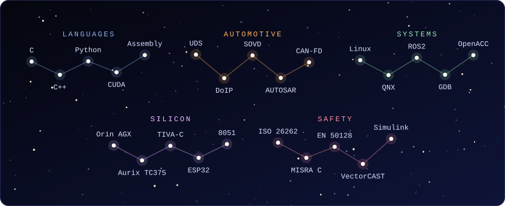

<!-- Generated by scripts/universe.py from scripts/README.template.md. Edit the template, not README.md. -->

**Embedded software engineer building onboard diagnostics for autonomous trucks.**

At **Torc Robotics** I work on the layer between a modern service-oriented diagnostic API and the ECUs underneath it:

- **SOVD -> UDS translation** - ASAM SOVD (REST diagnostics, Eclipse OpenSOVD) mapped onto ISO 14229 UDS
- **DoIP stacks** - ISO 13400 diagnostics over IP: routing activation, entity and gateway behavior
- **Diagnostic configuration** - CDD-driven DIDs, DTCs and routines

Before that: safety-critical railway software at Cyient (EN 50128, 100% MC/DC with VectorCAST) and automotive tooling at Vector India. MS in Embedded Systems, Oakland University.

- **CAN Bus Attack Vectors** - IEEE Wavelength, Apr 2024
- **Finding Earth-Like Planets and the Possibility of Life Beyond Earth** - Indian Aerospace Defense News, Jun 2023
- **Automated Data Acquisition for Photogrammetry** - IEEE ICRA
- **LiDAR 3D Point Cloud Performance Analysis** - IEEE ICMI, Apr 2024
- **Semi-Automated Workflow for 3D Model Reconstruction** - MS thesis, Dec 2024

